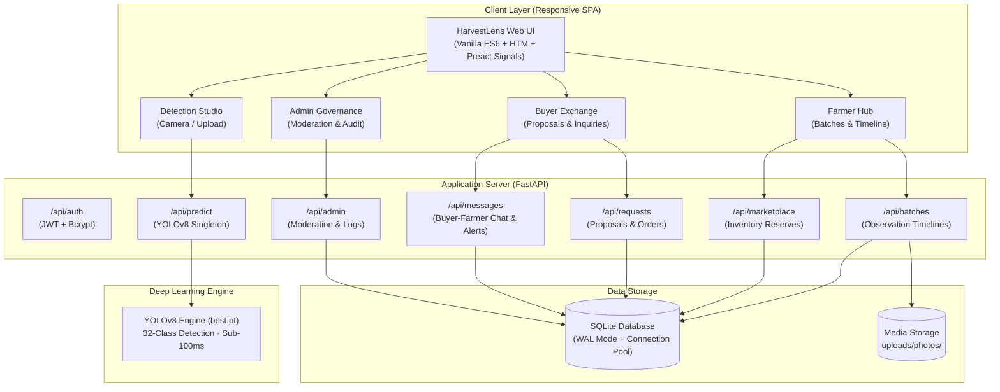

# 🌾 HarvestLens AI — Computer Vision Fruit Maturity & Agricultural Exchange Platform

<div align="center">

[](https://www.python.org/)
[](https://fastapi.tiangolo.com)
[](https://github.com/ultralytics/ultralytics)
[](https://pytorch.org/)
[-brightgreen.svg?logo=pytest&logoColor=white)]()
[](https://vercel.com)
[](LICENSE)

**See Nature. Understand Ripeness. Harvest Smarter.**

*An end-to-end intelligent computer vision platform connecting smart orchard management with an efficient, quality-graded agricultural marketplace.*

[Explore Features](#-key-features) • [Model Benchmarks](#-model-benchmarks--evaluation-results) • [Quick Start](#-quick-start) • [Vercel Deployment](#-vercel-deployment) • [API Documentation](#-api-endpoints)

</div>

---

## 📖 Executive Summary

Post-harvest fruit losses account for over 30% of agricultural waste worldwide, primarily driven by **mistimed harvesting**, **inaccurate manual maturity grading**, and **opaque supply chain negotiations**.

**HarvestLens AI** bridges computer vision and agricultural commerce:
1. **Automated Ripeness Detection**: A custom-trained **YOLOv8 neural network (`best.pt`)** recognizing **32 distinct fruit-maturity states** (8 fruit types across 4 development stages: *Unripe*, *Ripe*, *Overripe*, and *Rotten*).
2. **Orchard Batch Tracking**: Private farmer dashboards tracking crop development intervals, flowering dates, inspection cadences, and visual observation timelines.
3. **Quality-Graded Exchange**: A direct producer-to-buyer marketplace where farmers publish verified batches and commercial buyers place purchase proposals with automated inventory reservation.
4. **Bidirectional Notifications & Messaging**: Real-time in-app negotiation threads and live badge alerts across both Farmer and Buyer panels.
5. **Governance & Moderation**: Administrator oversight with compliance verification and tamper-resistant audit logs.

---

## 🏛️ System Architecture



---

## 🔬 Model Benchmarks & Evaluation Results

The underlying **YOLOv8** object detection model was rigorously evaluated on a genuine held-out test split of **526 images** containing **1,021 ground-truth annotations**.

### Overall Performance

| Metric | Score | Detail |
| :--- | :---: | :--- |
| **Precision (P)** | **74.81%** | Fraction of correct detections among all model proposals |
| **Recall (R)** | **74.89%** | Fraction of actual fruit instances detected |
| **F1-Score** | **74.85%** | Harmonic balance between precision and sensitivity |
| **mAP@50** | **71.82%** | Mean Average Precision at IoU threshold 0.50 |
| **mAP@50–95** | **59.31%** | Primary COCO metric across IoU thresholds 0.50:0.95 |
| **Inference Latency** | **96.0 ms** | Real-time CPU inference (~10.4 FPS on consumer hardware) |

### Performance Breakdown by Fruit Type

| Fruit Type | Test Instances | Precision | Recall | F1-Score | mAP@50 | mAP@50–95 |
| :--- | :---: | :---: | :---: | :---: | :---: | :---: |
| 🍎 **Apple** | 105 | **90.96%** | **93.26%** | **91.91%** | **91.67%** | **78.50%** |
| 🍌 **Banana** | 367 | 83.11% | 75.15% | 78.58% | 75.42% | 59.02% |
| 🍇 **Grape** | 248 | 71.46% | 46.05% | 53.46% | 45.37% | 27.37% |
| 🥭 **Mango** | 73 | **82.75%** | **88.73%** | **85.30%** | **78.81%** | **64.15%** |
| 🍈 **Melon** | 52 | 63.45% | 77.82% | 69.26% | 70.82% | 62.37% |
| 🍊 **Orange** | 97 | **81.87%** | **88.77%** | **85.12%** | **89.26%** | **77.90%** |
| 🍑 **Peach** | 44 | 71.97% | 78.39% | 72.17% | 71.64% | 63.04% |
| 🍐 **Pear** | 35 | 52.88% | 50.94% | 51.29% | 51.59% | 42.17% |

### Performance Breakdown by Maturity Stage

| Maturity Stage | Instances | Precision | Recall | F1-Score | mAP@50 | mAP@50–95 |
| :--- | :---: | :---: | :---: | :---: | :---: | :---: |
| 🟢 **Unripe** | 421 | 74.29% | 82.39% | **76.92%** | **78.98%** | **66.21%** |
| 🟡 **Ripe** | 301 | 77.14% | 70.95% | **71.99%** | **70.25%** | **56.62%** |
| 🟠 **Overripe** | 192 | 70.26% | 70.25% | **69.54%** | **65.98%** | **59.27%** |
| 🔴 **Rotten** | 107 | 77.53% | 75.96% | **75.10%** | **72.07%** | **55.16%** |

*All 32 class evaluation plots (PR curves, F1 curves, confusion matrices) are located in [`evaluation/reports/`](evaluation/reports/).*

---

## 🌟 Key Features

### 1. 🔍 Detection Studio
- **Live Camera & Photo Upload**: Capture orchard specimens directly on smartphone or upload high-resolution images.
- **Bounding Boxes & Ripeness Badges**: High-contrast, color-coded visual bounding overlays with confidence percentages.
- **Dynamic Confidence Filter**: Interactive slider adjusting detection thresholds in real time (5% to 90%).
- **1-Click Batch Integration**: Instantly register a detected fruit into an active orchard batch or initiate a new batch.

### 2. 🌾 Smart Orchard Batch Tracking
- **Private Farmer Isolation**: Server-side user tenancy ensuring batch records and harvest logs are strictly confidential.
- **Inspection Schedule Reminders**: Automated alerts flagging batches due for inspection based on custom day intervals.
- **Visual Observation Timeline**: Chronological log of high-resolution crop photos, dominant classification changes, and environmental field notes.

### 3. 🛒 HarvestLens Exchange (Marketplace)
- **Quality-Graded Public Listings**: Only farmer-verified batches with confirmed maturity, available weight, and unit price appear on the exchange.
- **Automated Inventory Locks**: Accepted purchase proposals automatically calculate reserved stock, ensuring growers never oversell their harvest.
- **Search & Filter Matrix**: Search listings by fruit variety, maturity grade, geographic region, and unit pricing.

### 4. 💬 Bidirectional Notifications & Messaging
- **Dual-Role Notification Center**:
  - **Farmers**: Receive alerts for new buyer proposals, chat inquiries, and overdue batch inspections.
  - **Buyers**: Receive immediate updates when proposals are accepted/declined and incoming messages from sellers.
- **Direct Marketplace Chat**: Click **"Chat"** directly on any listing card or proposal to start immediate negotiations.
- **Live Notification Badges**: Real-time counter tags on both the top navigation bar and sidebar navigation.

### 5. 🛡️ Admin Governance & Audit Logging
- **Listing Compliance**: Platform administrators can inspect and suspend non-compliant listings with mandatory justification logs.
- **Tamper-Resistant Audit Trail**: Every moderation action is recorded with administrator ID, target reference, reason, and immutable timestamp.

---

## 📁 Repository Structure

```
HarvestLens-AI/
├── backend/
│   └── app/
│       ├── config.py           # Configuration, JWT secrets, paths, and limits
│       ├── database.py         # SQLAlchemy engine with SQLite WAL optimization
│       ├── models.py           # Entities: User, Batch, Observation, Listing, Message, AuditLog
│       ├── schemas.py          # Pydantic v2 validation models
│       ├── security.py         # Bcrypt password hashing & JWT token handling
│       ├── ml/
│       │   └── detector.py     # YOLOv8 singleton inference engine & class parser
│       ├── routers/
│       │   ├── auth.py         # User registration, login, and instant role switching
│       │   ├── predict.py      # Multipart image upload & YOLOv8 inference endpoints
│       │   ├── batches.py      # Private batch CRUD & chronological observation logs
│       │   ├── marketplace.py  # Public listings, search, and publishing controls
│       │   ├── requests.py     # Purchase proposals, acceptance, and stock locks
│       │   ├── messages.py     # Bidirectional chat, inbox, and unread counters
│       │   └── admin.py        # Marketplace moderation & audit logging
│       └── main.py             # FastAPI application initialization & static mounting
├── frontend/
│   └── index.html              # Responsive single-page web application
├── dataset/
│   ├── data.yaml               # YOLOv8 dataset configuration
│   ├── valid/                  # Validation split (images & labels)
│   └── test/                   # Held-out test split (images & labels)
├── evaluation/
│   ├── README.md               # Methodology & metric documentation
│   └── reports/                # Evaluation report, confusion matrix, PR curves, CSVs
├── models/
│   └── best.pt                 # Trained 32-class YOLOv8 weights (6.5 MB)
├── tests/
│   ├── test_ml.py              # Model warmup, inference, and classification tests
│   ├── test_auth.py            # Authentication, registration, and role security tests
│   ├── test_batches.py         # Private batch multi-tenancy isolation tests
│   ├── test_marketplace.py     # Listing publishing, stock reservations, and moderation
│   └── test_messages.py        # Bidirectional messaging, unread counts, and proposal alerts
├── evaluate_model.py           # Standalone automated model evaluation engine
├── requirements.txt            # Python dependencies
├── vercel.json                 # Vercel deployment configuration
├── index.html                  # Root entry point (synchronized with frontend)
├── HarvestLens AI.html         # Synchronized standalone frontend distribution
├── run.py                      # One-click Windows application runner
└── README.md                   # Project documentation
```

---

## 🚀 Quick Start

### 1. Prerequisites
- **Python 3.10 or higher** (Tested on Python 3.10, 3.11, 3.12, 3.13)
- **Git**

### 2. Clone the Repository
```bash
git clone https://github.com/PrathameshGadewar/HarvestLens-AI.git
cd HarvestLens-AI
```

### 3. Install Dependencies
```bash
pip install -r requirements.txt
```

### 4. Run the Application
```bash
python run.py
```
*The server will start at `http://127.0.0.1:8000/` and automatically load the trained YOLOv8 weights.*

### 5. Access the Platform
- 🌐 **Web Application**: [http://127.0.0.1:8000/](http://127.0.0.1:8000/)
- 📚 **Interactive Swagger API Docs**: [http://127.0.0.1:8000/docs](http://127.0.0.1:8000/docs)
- 📖 **ReDoc Documentation**: [http://127.0.0.1:8000/redoc](http://127.0.0.1:8000/redoc)

---

## 👥 Pre-Configured Demo Accounts

For testing, use the **Role Dropdown** in the top navigation bar to switch roles with a single click, or log in manually:

| Role | Username | Password | Key Capabilities |
| :--- | :--- | :--- | :--- |
| 🧑‍🌾 **Farmer** | `farmer` | `farmer123password` | Manage private batches, log inspections, publish listings, accept purchase proposals |
| 🏢 **Buyer** | `buyer` | `buyer123password` | Browse marketplace, submit purchase proposals, chat with growers, view proposal status |
| 🛡️ **Admin** | `admin` | `admin123password` | Oversee all public listings, suspend non-compliant listings, review audit trail |

---

## ☁️ Vercel Deployment

HarvestLens AI is pre-configured for seamless deployment to **[Vercel](https://vercel.com/)** using [`vercel.json`](vercel.json):

### Steps to Deploy Frontend on Vercel:
1. Fork or push this repository to your GitHub account (`https://github.com/PrathameshGadewar/HarvestLens-AI`).
2. Log in to [Vercel](https://vercel.com) and click **"Add New Project"**.
3. Import your `HarvestLens-AI` repository.
4. Leave **Framework Preset** as **Other** (Root directory: `./`).
5. Click **Deploy**. Vercel will build and serve the application globally with edge caching.

> [!TIP]
> The frontend automatically connects to your local backend (`http://localhost:8000`) or can be pointed to any hosted backend instance (e.g. on Render, Railway, AWS, or Fly.io) by setting `localStorage.setItem('hl_api', 'https://your-backend.onrender.com')`.

---

## 🧪 Testing & Model Evaluation

### Run Full Test Suite (13 Automated Unit Tests)
```bash
python -m unittest discover -s tests
```
*Tests cover model inference latency, multi-tenancy isolation, marketplace inventory locking, role-based authorization, and real-time notification delivery.*

### Run Complete YOLOv8 Evaluation
```bash
python evaluate_model.py
```
*Evaluates `best.pt` across all 32 classes on the held-out test dataset, regenerating comprehensive metrics, confusion matrices, and precision-recall curves in `evaluation/reports/`.*

---

## 🛡️ API Endpoints

| Category | Method | Endpoint | Description |
| :--- | :---: | :--- | :--- |
| **Inference** | `POST` | `/api/predict` | Multipart upload for YOLOv8 fruit maturity detection |
| **Health** | `GET` | `/api/health` | Model status, memory usage, and backend health |
| **Auth** | `POST` | `/api/auth/register` | Register a new farmer, buyer, or admin account |
| | `POST` | `/api/auth/login` | Authenticate and obtain JWT Bearer token |
| | `POST` | `/api/auth/demo-login` | Instant demo login for evaluation |
| **Batches** | `GET` | `/api/batches` | List authenticated farmer's private batches |
| | `POST` | `/api/batches` | Register a new batch with variety and plot notes |
| | `POST` | `/api/batches/{id}/observations` | Append visual inspection photo and AI prediction |
| **Marketplace** | `GET` | `/api/marketplace/listings` | Public search with fruit, maturity, and region filters |
| | `POST` | `/api/marketplace/listings/{id}/publish` | Publish verified batch to exchange |
| **Requests** | `POST` | `/api/requests` | Submit purchase proposal on published listing |
| | `GET` | `/api/requests/incoming` | List incoming purchase requests (Farmer only) |
| | `PUT` | `/api/requests/{id}/status` | Accept, reject, or cancel purchase proposal |
| **Messaging** | `GET` | `/api/messages/inbox` | Retrieve user notification inbox |
| | `GET` | `/api/messages/unread-count` | Fetch real-time unread messages & pending count |
| | `POST` | `/api/messages` | Send direct inquiry or negotiation message |
| **Admin** | `POST` | `/api/admin/listings/{id}/moderate` | Suspend or restore public listing |
| | `GET` | `/api/admin/audit-logs` | Retrieve immutable administrative audit trail |

---

## 📄 License

This project is licensed under the **MIT License** — see the [LICENSE](LICENSE) file for details.

---

<div align="center">
Developed for Agricultural Computer Vision & Market Efficiency · <b>HarvestLens AI</b>
</div>
